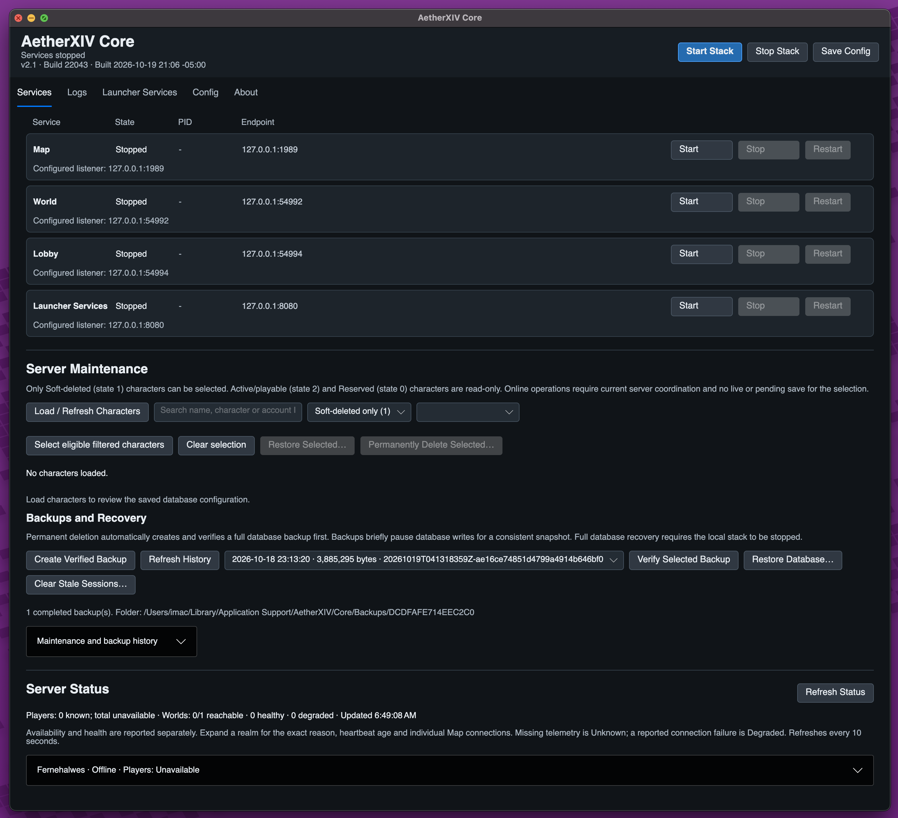
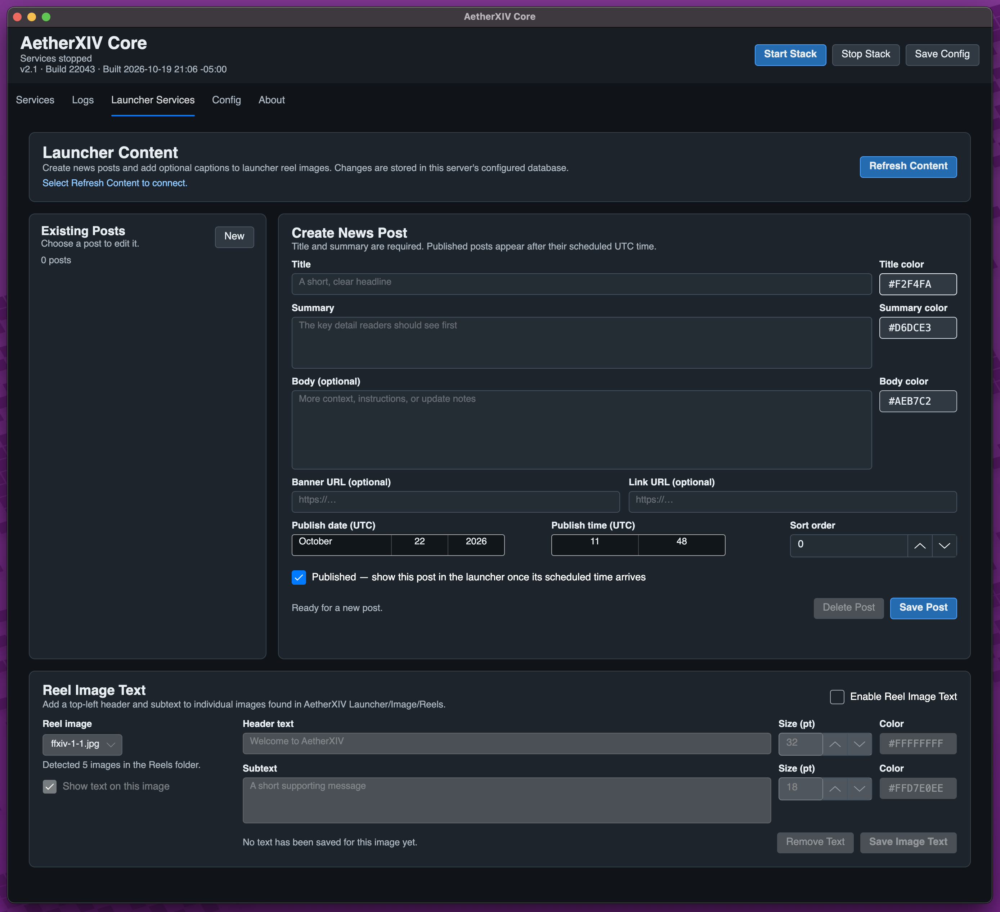
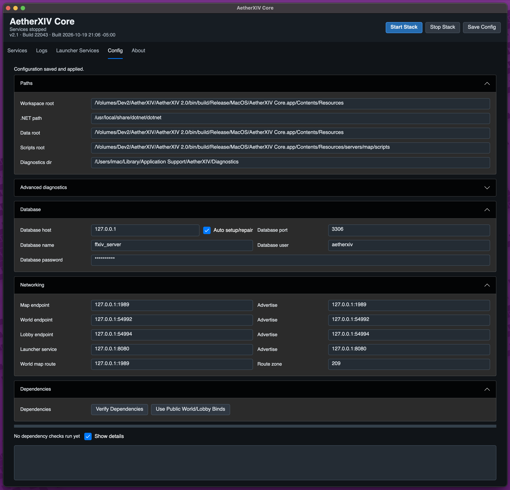

# AetherXIV Core Guide

AetherXIV Core is the graphical server-management application. It configures
the database and starts, stops, and monitors Map, World, Lobby, and Launcher
Services without displaying a shell or terminal window.

For a normal local installation, install MariaDB, open Core, verify the Config
tab, and select **Start Stack**.

Screenshots below were supplied from macOS and show the earlier `v2.1 / Build
22043` header. This guide covers 2.1.2 build 22044. Paths, timestamps, backup
entries, and realm names in the images are examples from that installation;
your values will differ.

## Services

The Services tab displays each service's state, process ID, and endpoint.



*Services, Server Maintenance, Backups and Recovery, and Server Status in one tab.
This example has the stack stopped and no character list loaded.*

- **Start Stack** starts Map, World, Lobby, then Launcher Services.
- **Stop Stack** stops the services in reverse order.
- Each row can start or stop one service for focused development work.
- Closing Core stops any services it launched.

Starting the stack performs dependency and database preflight first. Core can
request MariaDB administrator credentials for first-time setup or a reviewed
migration. Those administrator credentials are not stored.

When changing endpoints or service paths, stop the affected services, save the
configuration, and start them again.

### Server Maintenance

**Load / Refresh Characters** shows the configured database's characters, with
search, realm filters and explicit state labels. The legacy character states are
**0 — creation reservation**, **1 — soft-deleted**, and **2 — active/playable**.
Unknown states remain read-only. Only state-1 characters have selectable action
checkboxes; non-deleted characters cannot be restored or purged by this panel.
Nothing is selected automatically. “Select eligible filtered characters” selects
only visible, soft-deleted characters without a presence blocker. The selection
count includes selections hidden by later filters.

**Permanently Delete Selected…** previews names, IDs, realms and database, then
creates a full database backup and verifies its SHA-256 checksum before changing
any character data. A failed backup blocks deletion. The backend rechecks each
selected character's state and identity and deletes only those IDs in a single
transaction. Unselected characters, including other soft-deleted characters and
shared retainer inventory, are preserved. Linkshell owners must transfer or
remove the linkshell before permanent deletion. Character tables must use InnoDB
so failures can roll back.

**Restore Selected…** opens a dialog for replacement names and account slots
(0–7). Slot suggestions avoid active/reserved characters and other selected
restorations. Name, reserved-name, slot, account, realm and saved-data checks run
again inside the restoration transaction. Conflicts leave the dialog open for
correction. Completed characters restore to state 2, not reservation state 0;
incomplete character data blocks restoration.

Online operations require the upgraded World and Map runtimes to report support
for maintenance coordination. Server admission and maintenance share database
locks. Durable presence records cover World sessions and Map loading/saving;
characters with live or pending saves cannot be changed. Presence is never
considered safe simply because a heartbeat expired. Following a crash, **Clear
Stale Sessions…** is available only after local World/Map servers have stopped.
An old or unobservable running runtime blocks online maintenance. Character-name
caches refresh after committed changes. Operation history records operator,
target database, selected character IDs, results and associated backups.

The legacy schema has no deletion timestamp: creation date does not indicate
when a character was soft-deleted. No deletion-age filter is inferred from it.

### Backups and Recovery

**Create Verified Backup** creates a full SQL dump and checksum manifest. Backups
include tables, triggers, routines and events. A database table read lock provides
a consistent snapshot, including non-transactional legacy tables, and briefly
pauses writes while the dump runs. MariaDB dump/client tools must be installed;
Core also searches the configured database tool directory. The database account
needs the corresponding dump, table-lock and schema permissions.

**Verify Selected Backup** checks file size and SHA-256. Completed backups and
maintenance history are listed locally under the current user's
`AetherXIV/Core/Backups` application-data directory, separated by database target.
The optional `backupDirectory` setting changes the root directory. SQL backups
contain server/account data and use user-only filesystem permissions on Unix.
Verification confirms file integrity; it does not substitute for a recovery drill.

**Restore Database…** requires the local stack to be stopped and asks you to type
the database name. It verifies the selected backup, creates and verifies a recovery
backup of the current database, checks shutdown again under the coordination
lock, and imports the selected database snapshot. Tables introduced after the
snapshot are removed. Recovery is limited to the same database target, and stale
presence is cleared only while offline. SQL schema restoration is not atomic:
if import fails, use the saved recovery backup before restarting services. Remote
servers require shutdown and recovery on their host rather than treating a network
outage as proof they stopped.

### Server Status

Status refreshes every ten seconds and separates availability from health:

- **Healthy**: World responds, its heartbeat is current, and Map connections are established.
- **Starting**: a supervised process is becoming ready, or World is within its
  thirty-second initial Map connection grace period.
- **Degraded**: World responds and current telemetry reports a Map connection problem.
- **Health unknown**: World responds but matching telemetry is missing, stale or invalid.
- **Unreachable**: the endpoint cannot be reached from Core; remote network failure
  is not proof of shutdown. A stopped local supervised World displays **Offline**.

Expand a realm to see the reason, heartbeat timestamp, each Map connection,
last connection attempt, last success and last connection error. Disabled realms
retain a separate “Disabled in Lobby” marker. Summary counts distinguish
reachable, healthy and degraded worlds. Unknown player counts are never replaced
with a fabricated zero total.

World heartbeats report aggregate zone-session counts every five seconds; separate
chat channels do not double-count players. Heartbeats expire after fifteen
seconds. Map also publishes maintenance capability heartbeats. Supervised runtimes
write beneath the diagnostics directory's `world-status` folder. Standalone
runtimes use the current user's `AetherXIV/Core/status` application-data directory,
or `AETHERXIV_WORLD_STATUS_DIRECTORY` when set. Remote counts and online
maintenance need accessible heartbeat files from the matching runtimes.

Stack startup waits for each service's readiness signal before starting the next
service. World retries disconnected Map routes, with bounded connection attempts,
so a startup timing failure does not remain a permanent health warning.

Optional labels are preserved in `core-settings.json`. Merge this property into
the existing settings object; keep the other settings:

```json
{
  "realmLabels": {
    "1": { "type": "Development", "region": "North America", "markers": "Primary" }
  }
}
```

These labels are operator-provided; region and role are not inferred.

## Logs

Each service has a live output tab. The UI keeps a bounded preview so a noisy
service cannot consume memory indefinitely. Use persistent service logs or
structured diagnostics for a complete investigation rather than relying only
on the visible preview.

Map, World, and Lobby also write date-organized logs beneath their published
service folders, for example `servers/map/logs/<date>/map.log`.

## Launcher Services

This tab manages database-backed content shown by Launchers connected to this
server.



*Refresh Content connects to the configured database before you edit news posts
or reel-image text. Publish scheduling uses UTC.*

### News posts

Select **Refresh Content** to connect to the configured database. Create or edit
a post with:

- required title and summary;
- optional body, banner URL, and link URL;
- individual text colors;
- UTC publish date and time;
- sort order;
- published/draft state.

A published post appears only after its scheduled UTC time. Use **New** before
creating a separate post so an existing item is not overwritten.

### Reel image text

Core detects images in the packaged Launcher reel folder. Reel text has both a
global enable switch and a per-image enable switch. Each image can receive a
header and subtext with independent size and color. **Remove Text** removes the
database caption, not the image file.

## Config



*Config groups paths, database settings, bind/advertise endpoints, and dependency
checks. Packaged releases normally detect their own paths; do not copy the
development paths shown here.*

### Paths

- **Workspace root** is the source tree or published service root.
- **.NET path** launches the framework-dependent server services.
- **Data root** supplies server data.
- **Scripts root** supplies Map Lua scripts.
- **Diagnostics dir** receives structured trace runs.

Packaged releases normally detect these paths automatically. Avoid pointing a
release at a different version's service or data folders.

### Database

The default local database is `ffxiv_server` at `127.0.0.1:3306`, using the
`aetherxiv` application account. **Auto setup/repair** lets Core create, migrate,
and verify the packaged schema after receiving administrator credentials.
This includes a completely absent database and a manually created empty schema.
An older or incomplete schema is backed up and replaced with the canonical
database; compatible account and character data is restored on a best-effort,
count-verified basis.

The database password is saved in Core's settings file. Never attach that file
to a public report without redacting the password. Change the development
default before operating a shared or hosted server.

### Bind and advertise addresses

The **endpoint** or bind value controls where a service listens. **Advertise**
is the address other services or clients are told to use.

- Use `127.0.0.1` for an all-in-one server used only on the same computer.
- A remote server normally binds to an appropriate interface and advertises a
  hostname or address reachable by its clients.
- Do not advertise `127.0.0.1` to remote clients.

Default ports are Map `1989`, World `54992`, Lobby `54994`, and Launcher
Services `8080`. World Map Route points World to Map; Route Zone defaults to
`209`.

### Hosted example with HTTPS Launcher Services

For a VPS where `launcher.dev.example.com` terminates HTTPS in a reverse proxy
and the internal Launcher Services port is `8087`, use:

| Core field | Value |
|---|---|
| Map endpoint / advertise | `127.0.0.1:1989` |
| World endpoint | `0.0.0.0:54992` |
| World advertise | `game.dev.example.com:54992` |
| Lobby endpoint | `0.0.0.0:54994` |
| Lobby advertise | `game.dev.example.com:54994` |
| Launcher service endpoint | `127.0.0.1:8087` |
| Launcher service advertise | `launcher.dev.example.com:443` |
| World Map Route | `127.0.0.1:1989` |

Configure the reverse proxy to preserve `/launcher` and forward it to
`http://127.0.0.1:8087`. The Launcher profile then uses
`https://launcher.dev.example.com/launcher`, server host
`game.dev.example.com`, Lobby port `54994`, and World port `54992`. Leave Patch
Base URL empty unless an actual HTTPS patch repository is being hosted.

Expose TCP `443`, `54992`, and `54994`. Keep `3306`, `1989`, and the proxy-only
`8087` private. If Launcher Services is deliberately exposed directly instead
of through HTTPS, bind it to `0.0.0.0:8087` and use an explicit
`http://host:8087/launcher` URL; this is not recommended for public account
credentials.

Core blocks startup when World or Lobby advertises a public host but still
binds to `127.0.0.1`. The **Use Public World/Lobby Binds** button changes those
two listener hosts to `0.0.0.0` while preserving their ports; the public DNS
name still belongs in each **Advertise** field. After changing a running VPS,
stop and restart the stack. The Lobby log must report `0.0.0.0:54994` (or the
VPS interface address), not `127.0.0.1:54994`.

### Diagnostics

**Trace enabled** creates a separate run directory and writes structured JSONL
files for supported Map, World, and Lobby events. Regular service logs remain
available independently. The additional development logging controls are
development-facing; when collecting a report, rely on files actually produced
for that run rather than assuming every filter creates a separate file.

### Verify Dependencies

This checks the published/source layout, server executables, runtime, paths, and
other prerequisites without starting the stack. Resolve failed checks from top
to bottom.

## Configuration location

Core stores `core-settings.json` under the platform application-data folder:

- Windows: `%APPDATA%\AetherXIV\Core\core-settings.json`
- macOS: `~/Library/Application Support/AetherXIV/Core/core-settings.json`
- Linux/SteamOS: the application-data equivalent for `AetherXIV/Core`

Treat this file as a credential-bearing configuration file.

For database safety and recovery, read
[Database Setup, Updates, and Recovery](DATABASE_SETUP_AND_MIGRATION.md).
